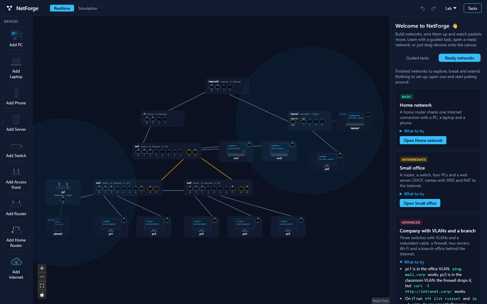
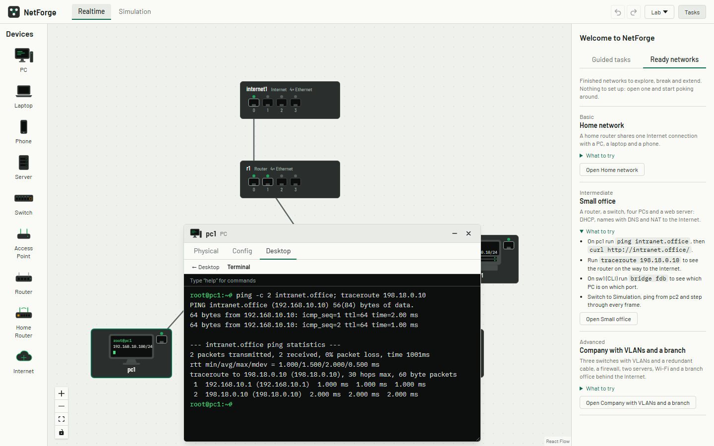
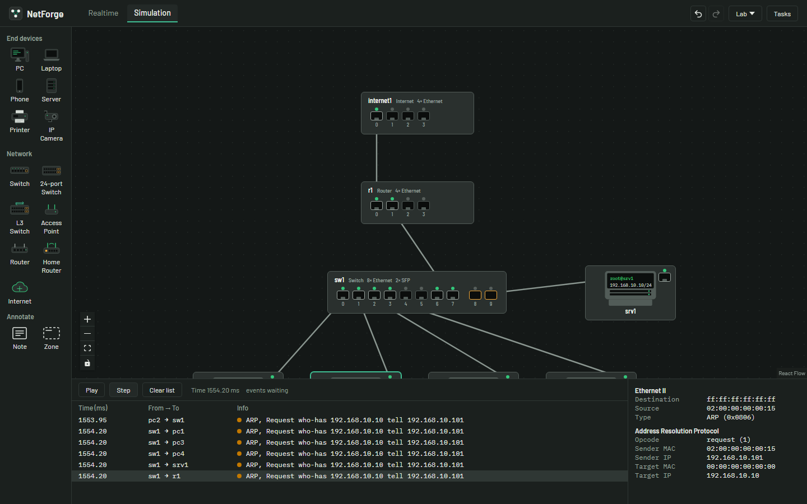
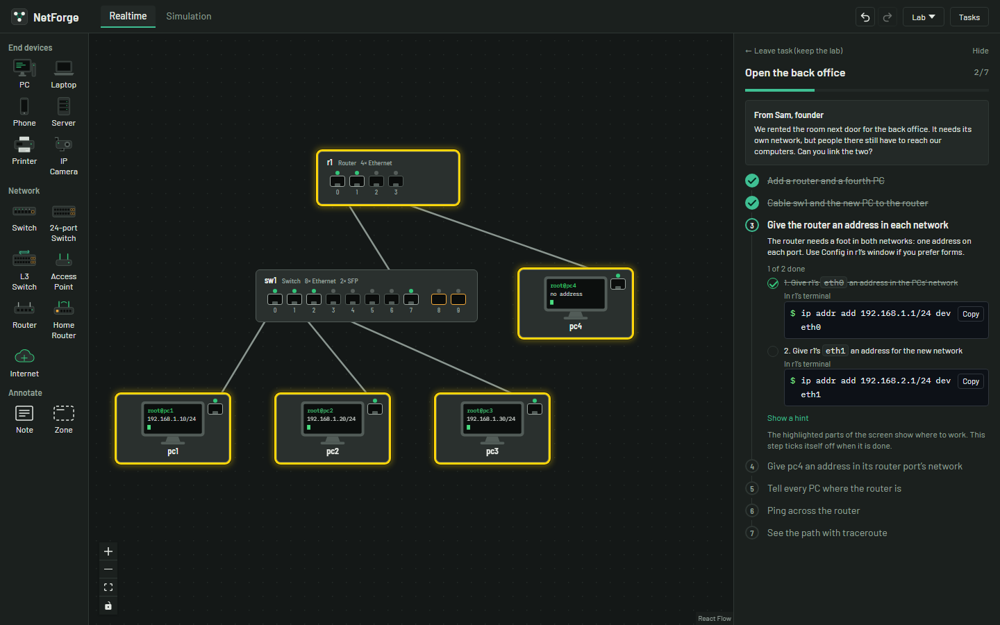

# NetForge

Build, wire and debug computer networks right in your browser. No install, no account.

**[Try the live demo →](https://netforge-20l.pages.dev/)**



NetForge is an open-source network simulator for learning. Drop hosts, switches and
routers on a canvas, connect them, configure them from a Linux-style shell, and watch
packets travel hop by hop. Guided tasks take you from "two machines that can ping each
other" to VLANs, routing, NAT, firewalls and VPNs. NetForge works offline after the first
visit.

> **Status:** Phases 0–7 are done: PCs, laptops, phones, servers, printers, IP cameras,
> 8- and 24-port switches, layer-3 switches, access points, Linux routers, home routers and
> an Internet cloud; Wi-Fi, VLANs, Spanning Tree, static and OSPF routing, DHCP with relay,
> DNS with forwarding, HTTP, mail, NAT and nftables firewalls, IPv6 with SLAAC, WireGuard
> VPNs and SSH; simulation mode, packet capture with pcap export, guided tasks that build
> one growing network, ready networks, troubleshooting challenges, "Why did this fail?"
> explanations, a task editor, progress reports, Linux script export, undo and share
> links. See [features](docs/FEATURES.md) and the [roadmap](docs/ROADMAP.md).

## A quick look

Open a ready network (home, small office or a company with VLANs) and poke around, or
follow a guided task that points at what to do next and checks your work.

| Linux-style shell on every device                                        | Every frame, step by step                                              |
| ------------------------------------------------------------------------ | ---------------------------------------------------------------------- |
|  |  |



## Principles

- **Runs entirely in the browser.** Static site, no backend.
- **Local-first.** Your labs are saved in your browser. Export them to a file to move
  to another device.
- **Vendor-neutral.** Devices are configured with Linux-style commands (`ip`, `nft`,
  `wg`), not a copy of any vendor's CLI.
- **Learn by doing.** Guided tasks check the real simulation state, not screenshots.

## Development

Requires Node.js 22+ (see `.nvmrc`).

```bash
npm install
npm run dev          # start dev server at http://localhost:5173
npm test             # unit tests (Vitest)
npm run test:e2e     # end-to-end tests (Playwright)
npm run lint
npm run typecheck
```

Read [CONTRIBUTING.md](CONTRIBUTING.md) before opening a pull request, and
[docs/ARCHITECTURE.md](docs/ARCHITECTURE.md) to understand how the pieces fit.

## Deployment

The site is a static build on Cloudflare Pages: <https://netforge-20l.pages.dev/>.

Every push to `main` is deployed by the `deploy` job in
[.github/workflows/ci.yml](.github/workflows/ci.yml), after lint, type check, unit tests
and end-to-end tests pass. The job needs two repository secrets:

- `CLOUDFLARE_ACCOUNT_ID`: the account that owns the `netforge` Pages project.
- `CLOUDFLARE_API_TOKEN`: an API token with the _Cloudflare Pages: Edit_ permission.

Without the token the job only prints a warning. To deploy by hand:

```bash
npm run build
npx wrangler pages deploy dist --project-name=netforge --branch=main
```

## License

[MIT](LICENSE)
